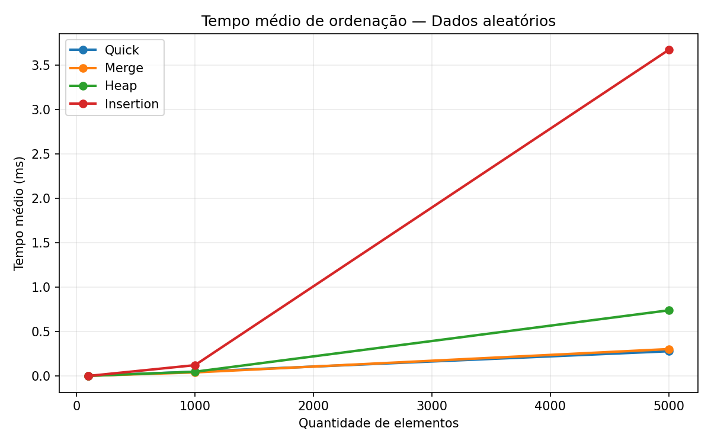

# Análise comparativa de algoritmos de ordenação em C

Projeto de estudo de **algoritmos, estruturas de dados e análise de desempenho**. Partiu de uma implementação simples de QuickSort em C e foi ampliado para comparar quatro métodos de ordenação por meio de testes automatizados e benchmarks reproduzíveis.

**Tecnologias:** C11, GCC, Make, GitHub Actions e Python/Matplotlib (somente para gráficos opcionais).

## O que o projeto faz

- Ordena vetores de inteiros com **QuickSort, MergeSort, HeapSort e InsertionSort**.
- Mostra tempo de execução, comparações entre elementos e escritas no vetor principal.
- Valida entradas do usuário e trata falhas de alocação.
- Verifica os quatro algoritmos com casos-limite e vetores aleatórios, usando `qsort` como referência; também testa a interface de linha de comando.
- Executa experimentos com dados aleatórios, ordenados, inversos e com valores repetidos, salvando resultados em CSV.
- Gera gráficos de tempo médio para apoiar a análise dos resultados.

## Comece aqui (Ubuntu/Linux)

Requisitos: `gcc` e `make`. No Ubuntu, podem ser instalados com `sudo apt install build-essential`.

```bash
make
printf '8\n9 3 5 -1 3 10 0 2\n' | ./bin/ordenacao quick
```

Saída (tempo e contagens podem variar):

```text
Vetor ordenado: -1 0 2 3 3 5 9 10
Tempo: ... ms
Comparacoes: ...
Escritas no vetor: ...
```

Troque `quick` por `merge`, `heap` ou `insertion`. O programa lê, da entrada padrão, **N seguido de N inteiros**, separados por espaços ou linhas. Aceita `N=0` e limita entradas interativas a 1.000.000 de elementos.

### Executar testes

```bash
make test
```

Inclui vetores vazios, unitários, já ordenados, inversos, com repetições, `INT_MIN`/`INT_MAX` e casos aleatórios. O GitHub Actions executa a compilação e os testes a cada `push` e `pull request`.

### Comparar desempenho

```bash
make bench
```

Gera `resultados/benchmarks.csv` com **5 repetições**, quatro cenários e tamanhos **100, 1.000 e 5.000**. Para personalizar:

```bash
mkdir -p resultados
./bin/benchmark resultados/benchmarks.csv 8 100 1000 5000 10000
```

Os números pseudoaleatórios usam uma semente fixa, e cada algoritmo recebe uma **cópia do mesmo vetor** em cada repetição. A geração dos dados, cópia para o vetor de trabalho e conferência da saída ficam **fora** da medição de tempo. A ordem dos algoritmos é alternada entre repetições para reduzir viés.

Formato do CSV:

```csv
cenario,algoritmo,tamanho,repeticao,tempo_ms,comparacoes,escritas
```

Para gerar os gráficos (dependência opcional):

```bash
python3 -m pip install -r requirements-graficos.txt
make graphs
```

Os quatro gráficos são gravados em `resultados/graficos/`. Há um **exemplo medido em ambiente de teste** em [`docs/exemplo-aleatorio.png`](docs/exemplo-aleatorio.png) e os dados completos em [`docs/exemplo-benchmark.csv`](docs/exemplo-benchmark.csv); os números não representam o desempenho do seu computador.



## Algoritmos e complexidades

| Algoritmo | Melhor caso | Caso médio | Pior caso | Espaço auxiliar | Estável? |
|---|---|---|---|---|---|
| QuickSort (mediana de três, 3 vias) | O(n) em entradas com todos os valores iguais; O(n log n) em distribuições típicas | O(n log n) | O(n²) | O(log n) de pilha | Não |
| MergeSort | O(n log n) | O(n log n) | O(n log n) | O(n) | Sim |
| HeapSort | O(n log n) | O(n log n) | O(n log n) | O(1) | Não |
| InsertionSort | O(n) | O(n²) | O(n²) | O(1) | Sim |

**Notas importantes:**
- O QuickSort usa **pivô pela mediana de três**, **partição de três vias** (boa para muitos elementos repetidos) e recursão somente sobre a menor partição a cada etapa. Isso reduz o uso da pilha, mas **não elimina** seu pior caso quadrático.
- O MergeSort é estável: em empates, escolhe primeiro o valor do lado esquerdo.
- O campo `comparacoes` conta comparações **entre valores** durante a ordenação; não conta verificações de índices. O campo `escritas` conta atribuições ao **vetor principal**, inclusive as feitas por trocas; não conta escritas no buffer auxiliar do MergeSort. Portanto, compare as métricas com cuidado.
- Os benchmarks incluem o custo de alocação temporária do MergeSort, quando aplicável, mas não incluem a alocação dos vetores de teste.
- Para vetores muito pequenos, tempos na faixa de microssegundos são ruidosos. **Resultados variam conforme processador, compilador, otimizações e carga da máquina**. Os gráficos são exploratórios, não provas de superioridade universal.

## Estrutura do repositório

```text
include/sorting.h                API compartilhada
src/sorting.c                   Implementação dos quatro algoritmos
src/main.c                      Interface de linha de comando
src/benchmark.c                 Experimentos com medição e CSV
tests/test_sorting.c            Testes de corretude
tests/test_cli.sh              Testes da interface de linha de comando
scripts/plot_results.py       Gráficos a partir do CSV
.github/workflows/ci.yml       Testes automáticos no GitHub
Makefile                       Comandos de compilação e execução
requirements-graficos.txt      Dependência opcional dos gráficos
docs/exemplo-aleatorio.png     Gráfico de exemplo
docs/exemplo-benchmark.csv     Dados que originaram o exemplo
```

## Aprendizados e possíveis extensões

Este projeto exercita **ponteiros, alocação dinâmica, modularização, recursão, validação de entradas, testes, análise assintótica e avaliação experimental**. Como próximas etapas, é possível investigar outros padrões de dados, medir consumo de memória e implementar uma versão híbrida do QuickSort com InsertionSort para partições pequenas.

**Origem:** evolução de um exercício autoral de QuickSort. A versão original também possuía um `public_html/index.html` vazio, que não foi mantido porque não fazia parte do programa de ordenação.

> Observação sobre publicação: personalize a descrição do repositório e o perfil do autor antes de subir para o GitHub. A licença de distribuição não foi definida neste pacote.
